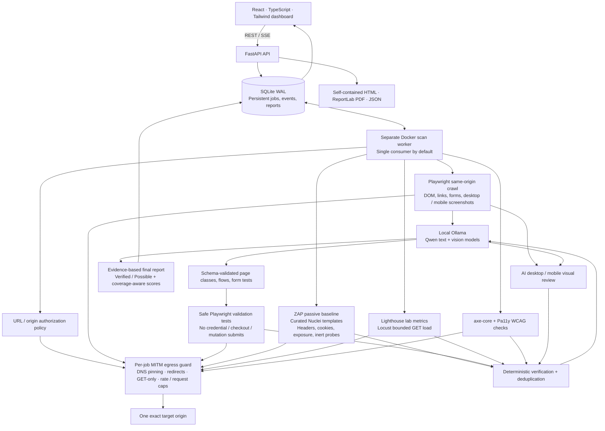

# Architecture — AI Universal Website Tester

A URL-only, black-box testing system. The application is MIT licensed. The default
AI models are Qwen2.5-1.5B-Instruct and Qwen2.5-VL-7B-Instruct, both Apache-2.0.
No proprietary model service or paid API is used.



The Mermaid diagram above is the canonical current architecture; the SVG in `docs/` is a static overview asset.

## Deployment

`docker compose up --build` starts the FastAPI UI/API container, a separate scan-worker
container, an isolated ZAP container, Ollama, and a one-shot automatic model bootstrap
container. `--profile labs` adds local Juice Shop and DVWA. The app image contains
Chromium, Playwright, Lighthouse, Pa11y, axe-core, Locust, Nuclei, and mitmproxy.
The frontend is built once and served by FastAPI, so browser requests always use
same-origin `/api` URLs.

The API and worker share the durable SQLite data volume. The API handles requests and
reports; the worker runs browser/scanner subprocesses. Keep exactly one worker for this
revision because ZAP and the job runner use shared state; do not scale it horizontally
without revisiting queue claims, ZAP isolation, artifacts and concurrency controls. The
worker advertises its own container hostname to ZAP so the scanner can reach the
per-job safety proxy. ZAP is attached **only** to the internal scanner network. The app
and Ollama also have the ordinary `web` network for model calls and local lab traffic.
Local lab origins are explicitly allowlisted; a public demo with the same product name
is not implicitly authorized. Native development keeps the simpler inline worker unless
`UWT_WORKER_MODE=external` is configured.

## Trust boundaries and safe execution

1. Normalize HTTP(S) URLs, reject userinfo, unsupported ports, control characters,
   malformed hosts, IP metadata/link-local/reserved targets, and unsafe action paths.
2. Compare **scheme + hostname + effective port**, never substring or suffix matching.
   All scans refuse non-allowlisted targets by default (`UWT_REQUIRE_ALLOWLIST_ALL_SCANS=true`).
   An administrator may explicitly opt in to passive checks on public sites; security and
   load adapters continue to refuse non-allowlisted origins.
3. Start a per-job mitmproxy guard. Resolve the target once and pin connections to
   that address. Private addresses require an explicit configured origin; metadata
   and link-local addresses remain forbidden. TLS upstream certificates are checked;
   clients trust the local proxy CA (browser clients ignore only the proxy certificate).
4. The proxy rejects cross-origin redirects/requests, all mutation methods, unsafe
   action paths and query keys, excess requests, large bodies, and unapproved hosts.
   Browser routing additionally rejects mutation traffic, service workers, downloads,
   and WebSockets. Third-party resources are deliberately blocked and this limitation
   is recorded; screenshots may differ from a normal browser on CDN-heavy websites.
5. Crawling is bounded by pages, depth, time, and a rate limit. Navigation uses a bounded load-event plus DOM-stability readiness heuristic instead of a fixed post-load sleep; this improves SPA discovery but is not a guarantee that all asynchronous work has finished. Only links are followed;
   arbitrary buttons are not clicked. Forms are filled and browser validity is observed,
   but no POST, password guess, registration, payment, upload, reset, or account change
   is sent. Login coverage is client-side only. After initial loading, form-case network callbacks are entirely blocked, including GET. Safe navigation and separate inert security probes remain subject to the proxy policy.
6. ZAP performs a **passive baseline** over the safe crawler's seed URLs. Its active
   scanner, attack mode, AJAX spider, and autonomous form spider are not used. Nuclei
   is restricted to the committed read-only templates; no downloaded template pack,
   OAST, headless, code, fuzz, or arbitrary templates are executed.
7. Reflection probes contain an inert custom HTML tag, not executable JavaScript.
   SQL probes are a single punctuation value, never UNION, time delays, stacked SQL,
   credentials, writes, or extraction. A reflected tag is **Possible**, not a proven
   exploitable XSS. SQL error signals remain **Possible** unless independent evidence
   proves otherwise.
8. Locust has hard limits of 20 users and 30 seconds, with a global proxy rate cap,
   request timeout, and an error/latency circuit breaker. Defaults are 4 users / 10 s.
9. AI sees bounded, redacted observations as untrusted data. It cannot issue requests,
   choose new targets, run code, generate selectors, change safety limits, upgrade
   verification status, or overwrite metric-derived scores. Every response is
   validated against a Pydantic JSON schema and IDs are checked against observations.

Read-only requests are the strongest practical black-box boundary, not a proof that
a badly designed target cannot mutate state on GET. Use disposable labs or owner-approved
staging targets. Never claim a comprehensive security audit from this limited scan.

## Meaningful AI responsibilities

- Classify observed pages and connect known page IDs into key user flows.
- Generate empty/invalid/boundary/special-character cases for discovered fields;
  Playwright executes the schema-valid cases and records the observed outcomes.
- Triage security signals with their verification results; probable false positives
  can be excluded from the primary report **only when deterministic re-testing also
  contradicts them**. Originals remain in `suppressed_findings` for audit.
- Review desktop and mobile screenshots with the local vision model. Visual judgments
  are always Possible and reference the exact screenshot.
- Propose deduplication groups, explain confirmed observations in plain language,
  write fixes, rank remediation priorities, and synthesize the executive summary.
  Deterministic checks validate proposed merges and retain all supporting evidence.

When Ollama is unavailable the measured scanners still run. Each AI task is recorded
as skipped/failed, and the report is explicitly partial; deterministic fallback cases
are labeled as such. This is not represented as an AI-complete run.

## Durable orchestration

SQLite uses WAL, parameterized statements, short transactions, and an atomic queue
claim. Docker runs a dedicated worker process; native development can use the inline
worker. The worker polls the shared durable queue, and it observes cancellation from
the API via persisted job state so an external process can stop the active pipeline.
On worker restart an interrupted job is returned to the queue once; repeated
interruption produces a clear failed state. Cancelling a job cancels the pipeline,
terminates scanner subprocess groups, and cleans up the per-job proxy. SSE events are
persisted with monotonic event IDs;
`Last-Event-ID` or `?since=` permits reconnect/replay without losing progress.

A scan failure produces a partial report with scanner-level failures rather than
silently returning 100. Scores measure observed issues and laboratory performance,
not a guarantee of safety. Unassessed or unauthorized pillars have a null score;
overall score averages only assessed selected pillars and is marked partial when
coverage is incomplete. All skipped tools and environment limits are visible.

## Data and export

Reports contain tool provenance, measurements, sitemap, AI tasks, generated test
cases, per-tool coverage, verification observations, suppressed findings, and issue
evidence. Secret values, cookie values, tokens, and exposed environment contents are
not retained. Screenshots can still contain sensitive information: reports are local
by default, no external analytics are used, and deployment ports bind to loopback.
HTML is escaped and self-contained; PDF is generated by ReportLab; JSON preserves
machine-readable results. Evidence endpoints are job-scoped with basename-only paths.

## Repository layout

```text
backend/app/core/       configuration, models, target policy, SQLite, proxy lifecycle
backend/app/ai/         Ollama transport and schema-validated AI tasks
backend/app/scanners/   crawl/forms, custom security, ZAP, Nuclei, Lighthouse,
                       Locust, axe-core, Pa11y
backend/app/pipeline/   orchestration, verification, deduplication, scoring
backend/app/api/        API routes, SSE replay, exports
backend/tests/          policy, safety, scoring, persistence, API, adapter tests
frontend/src/           dashboard, progress, reports, history, issue drawer
 tools/                Node scanner runner, mitmproxy addon, Locust file,
                       reviewed Nuclei templates
scripts/               smoke check and reproducible sample generation
samples/               real Juice Shop report and execution manifest
```
